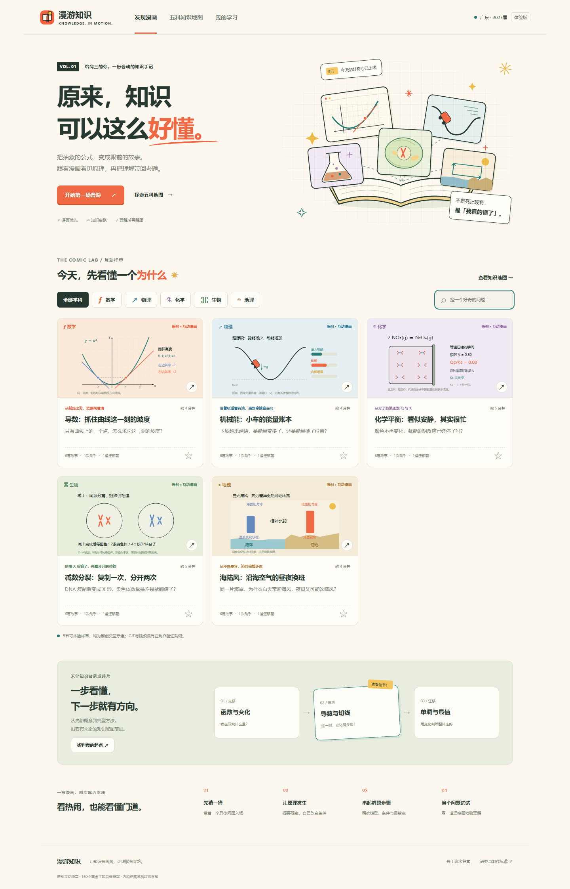

# 漫游知识 · Knowledge in Motion

面向广东2027届高三一轮复习的五科知识漫画平台研究与互动原型。让抽象机制看得见，让知识按依赖连起来，让理解能回到解题。

**当前是研究与体验版。** 五科40章160个聚合主题是待制作目录；5节互动样章可以阅读、操作和答题。没有把目录称为160篇漫画，也没有将网页动画称为GIF或视频成品。



## 已有内容

- 数学：导数与切线；物理：机械能与摩擦；化学：动态平衡与等温压缩；生物：减数分裂计数；地理：海陆风。
- 每科样章6幕原创对话、有限科学动画、条件/易错点、解题步骤、原创迁移题与解释、事实核查来源。
- 学科筛选、样章搜索、跨五科目录搜索、先修详情、本机收藏、阅读位置恢复、答题记录与导出。
- 响应式界面、键盘前后翻幕、读者控制速度、静态观察与减少动态模式。

## 运行

需要Node.js 22或更新版本。平台无运行时npm依赖，无需密钥。

```sh
npm run dev
```

打开终端显示的本地地址（默认4173）。也可以用任意静态服务器托管本目录。直接双击HTML受浏览器模块和文件读取限制，请使用静态服务器。GitHub Pages直接发布根目录即可，不需要构建。

```sh
npm run check
```

浏览器验收脚本使用Playwright 1.61.1，已锁定为开发依赖：先`npm ci`，按需`npx playwright install chromium`，启动本地服务，再运行`node scripts/smoke.mjs`。运行平台本身不需安装这些开发依赖。实际结果见[验证记录](docs/VALIDATION.md)。

## 资料入口

- [研究结论与平台蓝图](docs/RESEARCH-BRIEF.md)
- [五科课程研究](docs/curriculum-research.md) / [结构化目录](content/curriculum.json)
- [产品与学习科学研究](docs/product-research.md) / [一手来源记录](docs/references-product.json)
- [中文知识漫画原画案例与科学辨析](docs/comic-case-study.md)
- [Image 2.6与当前GIF出口实测](docs/image-capability.md)
- [样章科学核查](docs/sample-science-review.md) / [图形整合检查](docs/diagram-review.md)
- [项目状态和交接](docs/PROJECT-STATUS.md)

## 内容边界

2027广东最终适用说明、具体教材版本及2025修订全文映射仍待核对。科学脚本做过自查，尚未通过任课教师教审；没有开展广东高中生偏好访谈或学习效果试验。单题通过不等于章节掌握。

OpenAI官方文档支持Image 2.6原生GIF，但当前内置入口一次实测只返回PNG分镜表。原型没有调用付费API、没有暴露密钥、没有接入原生GIF生产接口。正式视频与OpenFilm项目尚未制作。

## 源码、资产与许可

完整前端源码、原创内容、必要封面资产、研究与验证记录保存在本仓库。无构建目录；第三方教材PDF、竞品截图、原片、个人配置和密钥不入库。

代码按[MIT](LICENSE)；原创教学文字、脚本与原创资产在可许可范围内按[CC BY 4.0](CONTENT-LICENSE.md)。事实核查链接保留原权利归属，不把第三方内容改授MIT。内置生图的封面请求两次网络失败，本版封面使用原创SVG界面图形；没有伪造AI插画产出。科学图层独立实现并校核。详见[素材台账](docs/ASSETS.md)。

## 更新

2026-11-05 v0.1：完成第一阶段调研、160聚合主题目录、5节样章及交互体验版。实际验证和剩余缺口随工程状态更新，不保证提分或全课程已完成。
