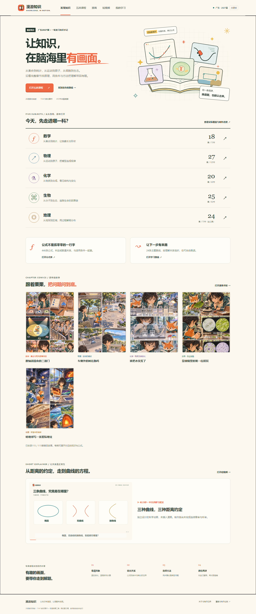

# 漫游知识 · 广东2027五科可视化复习

[在线体验](https://yangwei251003.github.io/manyou-knowledge-comics/) · [漫画书架](https://yangwei251003.github.io/manyou-knowledge-comics/#comics) · [五科课程](https://yangwei251003.github.io/manyou-knowledge-comics/#map) · [实际覆盖](https://yangwei251003.github.io/manyou-knowledge-comics/#coverage)

面向广东2027届高三一轮复习，按人教版26册教材的114章及一个地理工具章组织。每章都有一篇漫画故事，学生可以按格阅读，再展开对应知识和公式，接着做章内例题。



## 当前实际能力

- 五科413节、1260条知识说明、446条公式或关系；115道章末例题及10道题型迁移示例。
- 已渲染1条独立讲解短片，中文合成旁白、字幕与授权配乐；仍待连续看审和听审。
- 按册目录、160主题方法提要、跨科搜索、公式回跳与24条主题路线。
- 115篇ImageGen章回故事、451格分镜，覆盖全部413节。另收录8页专题漫画、5个原有分步模型和5个新增可调模型。
- 原理复述、阅读标记、章节收藏、思路笔记和导出；记录只保存在当前浏览器。

## 状态边界

漫画以教材节为分格。场景帮助理解核心概念，细分知识、精确公式及适用条件见分格知识卡和章内讲解。目前为原创复习稿，尚待教师教审和真实学生验证。

## 本地运行

需要Node.js。

```sh
npm ci
npm run dev
npm run check
npm run test:browser
```

浏览器测试使用Playwright Chromium。首次安装浏览器：`npx playwright install chromium`。网站本身无运行时npm依赖，使用原生ES模块；GitHub Pages可静态运行。

## 核对与维护

[逐册覆盖与来源](docs/FULL-CURRICULUM-AUDIT.md) · [目录匹配证据](docs/toc-audit.json) · [科学自查](docs/FULL-CONTENT-REVIEW.md) · [章回漫画与四视角走读](docs/CHAPTER-COMICS.md) · [运行验证](docs/VALIDATION.md)

`content/`是结构化原稿，`src/`为界面及精确模型，`production/`保留漫画提示词、散列和审核状态。历史160主题仍在`content/curriculum.json`，当前课程不以它为分母。教材原件与未通过图稿存本地忽略目录，不上传第三方教材PDF或扫描页。

## 许可与归属

代码MIT；本项目原创整理、题目与图像按[内容许可](CONTENT-LICENSE.md)说明分享。引用的一手材料、第三方模板、字体或音频保留各自权利和许可，不能从代码许可推导其素材许可。

## 更新

- 2026-11-06 补齐五科115章漫画故事，加入按册书架、逐格对白、知识与公式卡及整页预览。
- 2026-11-06：按26册、114教材章重建课程；加入跨科公式、学习路线、完整章节阅读、8页漫画与5个新模型；409个教材节标题与资料规范化匹配通过。
- 2026-11-05：发布五个科学交互样章与160主题历史规划。
